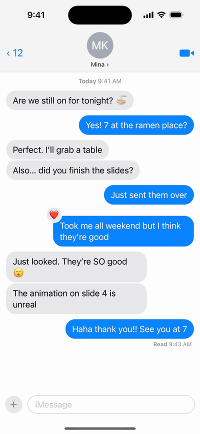
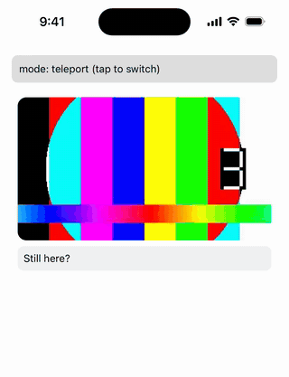
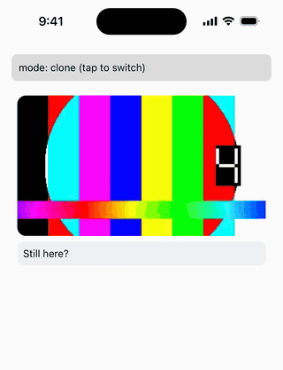

# react-native-lift

Long-press a view to lift it above the screen with a context menu, like iOS context menus or Telegram message reactions.

<p align="center">
  
</p>

<p align="center">An iMessage-style chat from the example app: long-press a bubble for tapbacks and a menu.</p>

> **0.x preview.** Tested on a real Android device (Samsung Galaxy S21, SM-G991N, Android 15) and on the iOS simulator. Testing on a real iPhone is planned before 1.0. If something looks wrong on a real device, please [open an issue](https://github.com/youthfulhps/react-native-lift/issues).

The lifted view is the real view, not a copy. It is moved into an overlay with [react-native-teleport](https://github.com/kirillzyusko/react-native-teleport), so a playing video keeps playing, a text field keeps what you typed, and nothing is mounted twice. The menu is drawn by React Native and looks the same on iOS and Android.

<table>
  <tr>
    <th>react-native-lift (teleport)</th>
    <th>Copied into a modal (clone)</th>
  </tr>
  <tr>
    <td></td>
    <td></td>
  </tr>
</table>

The same cell and the same steps, recorded side by side: type into the field, then long-press. Lifted, the video counter keeps counting and the typed text stays. The copy, the usual approach, starts the video over at 0 with an empty text field.

## Requirements

- React Native ≥ 0.83 (Expo SDK ≥ 55), New Architecture
- react-native-reanimated ≥ 4.2, with the react-native-worklets version it requires
- react-native-gesture-handler ≥ 2.30 (2.x or 3.x)
- react-native-teleport ≥ 1.2.2

Tested on Expo SDK 55 (React Native 0.83) and SDK 58 (React Native 0.88).

## Installation

```sh
npm install react-native-lift react-native-teleport react-native-reanimated react-native-worklets react-native-gesture-handler
```

With Expo, install the native peers with `npx expo install` so they match your SDK. react-native-teleport has native code, so use a development build, not Expo Go.

With bare React Native, run `pod install` in `ios/` afterwards, and add `react-native-worklets/plugin` as the last plugin in `babel.config.js`, as the [Reanimated installation guide](https://docs.swmansion.com/react-native-reanimated/docs/fundamentals/getting-started/) describes. The example app is an Expo development build; bare React Native setups are not tested yet.

The examples below also use [react-native-safe-area-context](https://github.com/appandflow/react-native-safe-area-context) for the safe area insets (optional).

## Usage

Wrap the app once, inside `GestureHandlerRootView`:

```tsx
import { GestureHandlerRootView } from 'react-native-gesture-handler';
import { SafeAreaProvider, useSafeAreaInsets } from 'react-native-safe-area-context';
import { LiftProvider } from 'react-native-lift';

export default function App() {
  return (
    <SafeAreaProvider>
      <Root />
    </SafeAreaProvider>
  );
}

function Root() {
  const insets = useSafeAreaInsets();
  return (
    <GestureHandlerRootView style={{ flex: 1 }}>
      <LiftProvider insets={insets}>
        <Navigation />
      </LiftProvider>
    </GestureHandlerRootView>
  );
}
```

Then wrap any view in `Liftable`:

```tsx
import { FlatList } from 'react-native';
import { Liftable, useLiftScrollLock } from 'react-native-lift';

function Messages({ messages }) {
  const scrollEnabled = useLiftScrollLock();
  return (
    <FlatList
      data={messages}
      scrollEnabled={scrollEnabled}
      renderItem={({ item }) => (
        <Liftable
          menu={[
            { key: 'reply', title: 'Reply', onPress: () => reply(item) },
            { key: 'delete', title: 'Delete', destructive: true, onPress: () => remove(item) },
          ]}
        >
          <Bubble message={item} />
        </Liftable>
      )}
    />
  );
}
```

- A long press lifts the view. The menu opens next to it. Tapping an item, or anywhere outside the view, drops it back.
- `useLiftScrollLock()` returns `false` from the long press until the view is back in place. Pass it to `scrollEnabled` so the list cannot scroll away under the lifted view.

### Where to put `LiftProvider`

- Put it at the window origin, around your whole navigation tree, not inside a `SafeAreaView`. The overlay covers the provider's area, and `insets` are measured from its edges. Inside a `SafeAreaView` the insets count twice.
- `insets` defaults to 0. Pass `useSafeAreaInsets()` so the menu stays clear of the notch and the home indicator.

### Recycling lists: `itemKey` is required

On FlashList (or any list that recycles cells), pass the item's id as `itemKey`:

```tsx
<FlashList
  data={messages}
  renderItem={({ item }) => (
    <Liftable itemKey={item.id} menu={menu(item)}>
      <Bubble message={item} />
    </Liftable>
  )}
/>
```

If the list rebinds the cell to another item while it is lifted, the view drops at once. Without `itemKey`, the overlay would show the other item.

### Props

| Prop | Description |
|---|---|
| `menu` | Menu items: `{ key, title, icon?, destructive?, onPress, restoreFocus? }`. Also exposed as accessibility actions, which run the item without a lift. |
| `renderMenu(items, close)` | Replaces the default menu. `close()` drops the view. |
| `renderAccessory(close)` | Extra content next to the view, such as a reaction bar. |
| `accessoryPosition` | `'top'` (default) or `'bottom'`. |
| `renderBackdrop({ visible })` | Replaces the default dim. See [Blur backdrop](#blur-backdrop). |
| `haptics` | Called once when a long press lifts the view. See [Haptics](#haptics). |
| `motion` | Override any animation value: `press`, `release`, `drop`, `backdrop`, `menu`. |
| `itemKey` | Identity of the item in a recycled cell. Required on recycling lists. |
| `onLiftStart`, `onLiftEnd` | Called when the view has lifted and when it is back in place. |
| `restoreFocus` | Refocus the text field the lift closed the keyboard of. Default `true`. |
| `longPress` | `false`: lift only from code. |
| `disabled` | No long press, no `ref.lift()`, no accessibility actions. |
| `scale` | Your own press-scale shared value, to animate it yourself. |
| `accessible` | Defaults to `true` when there is a menu. See [Known limitations](#known-limitations). |
| `style` | Style of the slot the view sits in, such as `alignSelf` for a chat bubble. The view fills the slot's height only when this style sets one (`flex`, `height`, `minHeight`, …). |

### Lift from code

```tsx
const ref = useLiftRef();

<Liftable ref={ref} menu={menu}>…</Liftable>;

ref.current?.lift();
ref.current?.drop();
ref.current?.drop({ immediate: true }); // no animation
```

`haptics` is not called for `ref.lift()`. Call your haptic yourself when you lift from code.

## Recipes

### Haptics

`haptics` is called only when a long press lifts the view. With expo-haptics:

```tsx
import * as Haptics from 'expo-haptics';

const liftHaptic = () => Haptics.impactAsync(Haptics.ImpactFeedbackStyle.Medium);

<Liftable haptics={liftHaptic} menu={menu}>…</Liftable>;
```

### Blur backdrop

`renderBackdrop` replaces the dim. Fade on `visible` over `motion.backdrop.duration` (200 ms by default): a drop puts the view back once that fade is done. This one blurs on iOS and dims on Android, where blur is experimental and costly:

```tsx
import { BlurView } from 'expo-blur';
import { useEffect } from 'react';
import { Platform, StyleSheet, View } from 'react-native';
import Animated, { useAnimatedStyle, useSharedValue, withTiming } from 'react-native-reanimated';

function BlurBackdrop({ visible }: { visible: boolean }) {
  const opacity = useSharedValue(0);
  useEffect(() => {
    opacity.value = withTiming(visible ? 1 : 0, { duration: 200 });
  }, [visible, opacity]);
  const style = useAnimatedStyle(() => ({ opacity: opacity.value }));
  return (
    <Animated.View pointerEvents="none" style={[StyleSheet.absoluteFill, style]}>
      {Platform.OS === 'ios' ? (
        <BlurView intensity={30} tint="systemMaterial" style={StyleSheet.absoluteFill} />
      ) : (
        <View style={[StyleSheet.absoluteFill, { backgroundColor: 'rgba(0, 0, 0, 0.25)' }]} />
      )}
    </Animated.View>
  );
}

<Liftable renderBackdrop={(state) => <BlurBackdrop {...state} />} menu={menu}>…</Liftable>;
```

Return an element and keep hooks inside its component.

### Drop when the screen loses focus (React Navigation)

A screen that stays mounted under a pushed screen keeps its lifted view. Drop it when the screen loses focus:

```tsx
import { useFocusEffect } from '@react-navigation/native';
import { useCallback, type RefObject } from 'react';
import type { LiftHandle } from 'react-native-lift';

function useDropOnBlur(ref: RefObject<LiftHandle | null>) {
  useFocusEffect(useCallback(() => () => ref.current?.drop({ immediate: true }), [ref]));
}
```

## Known limitations

- **One lift at a time.** While a view is dropping (about 200–350 ms), lifting another view is ignored. In code, `a.drop(); b.lift()` back to back ignores `b.lift()`; lift `b` from `a`'s `onLiftEnd`.
- **Keyboard:** lifting while the keyboard is open closes it first and lifts once it is gone, so the lift starts later than usual (about 0.6 s on iOS). The text field gets focus back after the drop (`restoreFocus`).
- **Very tall views** shrink to fit next to the menu, down to half size. If still too tall, the side away from the menu is cut where it no longer fits: at the edge of the safe area, or at the accessory when the accessory is on that side. The cut part shows again as soon as the drop starts.
- **`renderMenu` and `renderAccessory` render in the overlay** under `LiftProvider`. Hooks inside them see `LiftProvider`'s context, not the context around the `Liftable` (navigation, theme). Read those values in your component and close over them.
- **Accessibility:** with a menu, the `Liftable` becomes one accessibility element, because iOS exposes actions only on accessible elements. `accessible={false}` turns that off, but then iOS does not expose the menu actions. Actions are named after the item titles. With two items of the same title, the first one runs.
- Turning on `disabled` while the view is lifted does not drop it.
- A menu or accessory that appears after the view has been placed is not shown until the next lift.

### Android: one tap ignored after a long press on `VideoView`

On Android, after a long press that starts on an expo-video `VideoView` (`nativeControls={false}`), the next single tap anywhere in the app is ignored. Later taps work.

- **Cause:** react-native-gesture-handler intercepts the long press, then sends a cancel for that touch when the next tap starts. `VideoView` forwards that cancel to JS itself, and the cancel ends the new tap. This applies to any native view that forwards its own touches to JS. A `WebView` is not affected.
- **Not caused by lifting:** any react-native-gesture-handler long press on a `VideoView` does the same, without react-native-lift.
- **Workaround:** wrap the video in `<View pointerEvents="none">`. **Side effect:** the `VideoView` then receives no touches at all, lifted or not. Taps on the video itself do nothing.

## Example app

`example/` is an Expo app with an iMessage-style chat with tapbacks, a chat on FlashList with reactions, a photo grid, a video feed, and a teleport vs. clone comparison.

```sh
yarn
yarn example ios     # or: yarn example android
```

## Contributing

Issues and pull requests are welcome. See [CONTRIBUTING.md](CONTRIBUTING.md) for the setup, the example app and the design rules. Report security issues as described in [SECURITY.md](SECURITY.md).

## License

MIT
